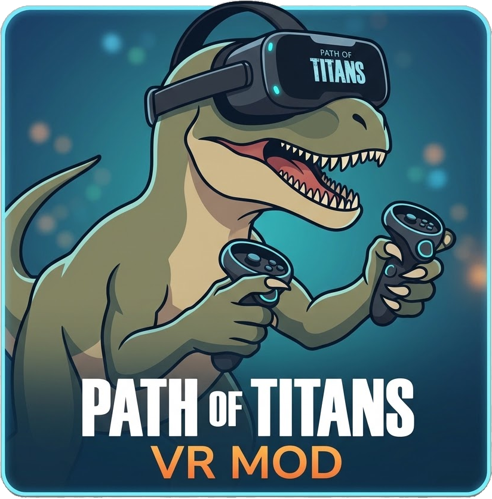

# Path of Titans VR Launcher



An unofficial, one-click VR launcher for **Path of Titans**. It finds the game,
launches it at a VR-tuned resolution, and injects the [UEVR](https://github.com/Praydog/UEVR)
VR backend automatically — no fiddling with the stock injector.

> 📖 Full gameplay/tuning guidance: **[VR Notes](https://github.com/cybershrimp23/PathOfTitans_VR/blob/main/assets/vr_notes.md)**
> (also available in-app under **Help → VR Notes**).

## Features
- Auto-detects the game and the UEVR build; browse to override.
- Launches windowed at 1280×1024 (VR-tuned) and injects `UEVRBackend.dll`.
- OpenVR (default) or OpenXR runtime selection.
- Optional plugin-nullifier to disable competing VR runtimes.
- Protects your desktop resolution: backs up `GameUserSettings.ini` before a VR
  session and restores it when the game exits.
- Optional wipe of the per-game UEVR settings folder each launch.
- NSIS Windows installer (per-user, no admin) with uninstall support.

## What's in this repo
| Path | Contents |
|------|----------|
| `src/` | Rust source: `main.rs` (eframe UI), `config.rs`, `discover.rs`, `inject.rs` (DLL injection + process watch), `game_settings.rs` (desktop-resolution protection). |
| `build.rs` | Embeds the app icon + version metadata into the exe (Windows). |
| `assets/` | `icon.png`, `icon.ico`, and the compiled-in `vr_notes.md` help document. |
| `installer/` | `PoTVRLauncher.nsi` NSIS installer script + `LICENSE.txt` (EULA shown during setup). |
| `build.ps1` | One-shot build: UEVR backend → launcher → installer. |
| `PoT_UEVR/` | Git **submodule** — the UEVR fork (`cybershrimp23/PoT_UEVR`) that produces `UEVRBackend.dll`. |
| `dist/` | Build output: the packaged `PoTVRLauncher-Setup-<version>.exe` (gitignored). |
| `LICENSE` | MIT license for the launcher. |

## Build
### Prerequisites
- Rust toolchain (`cargo`).
- Visual Studio 2022 Build Tools + CMake (only needed to compile the UEVR stage).
- NSIS: `winget install NSIS.NSIS` (for the installer step).

### Steps
```bash
# Clone with the UEVR submodule
git clone --recurse-submodules https://github.com/cybershrimp23/PathOfTitans_VR.git
cd PathOfTitans_VR

# Build everything (UEVR backend -> launcher -> installer)
powershell -ExecutionPolicy Bypass -File .\build.ps1
```
The installer is written to `dist\PoTVRLauncher-Setup-<version>.exe`.
Stage flags: `-SkipUevr`, `-SkipLauncher`, `-SkipInstaller`, `-Clean`
(e.g. `.\build.ps1 -SkipUevr` builds just the launcher + installer).

Only the launcher needs to be run/tested directly:
```bash
cargo run --release
```

## Usage
Run the launcher and press **Launch VR**. Inside the game, press **Insert** to
open the UEVR GUI for recentering and all tuning options. Settings live under
**File → Settings**, and gameplay notes are under **Help → [VR Notes](https://github.com/cybershrimp23/PathOfTitans_VR/blob/main/assets/vr_notes.md)**.

## License
Released under the [MIT License](LICENSE).

## Privacy
This launcher collects **no user data** — no analytics, telemetry, or network
calls. It only reads/writes local files and launches the game.

## Disclaimer
- **Use the mod at your own risk.** It injects a third-party mod with anti-cheat
  disabled; this may violate the Path of Titans Terms of Service and could get
  your account restricted or banned. There is **absolutely no warranty**.
- **PATH OF TITANS** and **Alderon Games** are trademarks of **Alderon Games Inc.**
  This is an independent, unofficial community tool — **not affiliated with,
  endorsed by, or sponsored by Alderon Games**.
